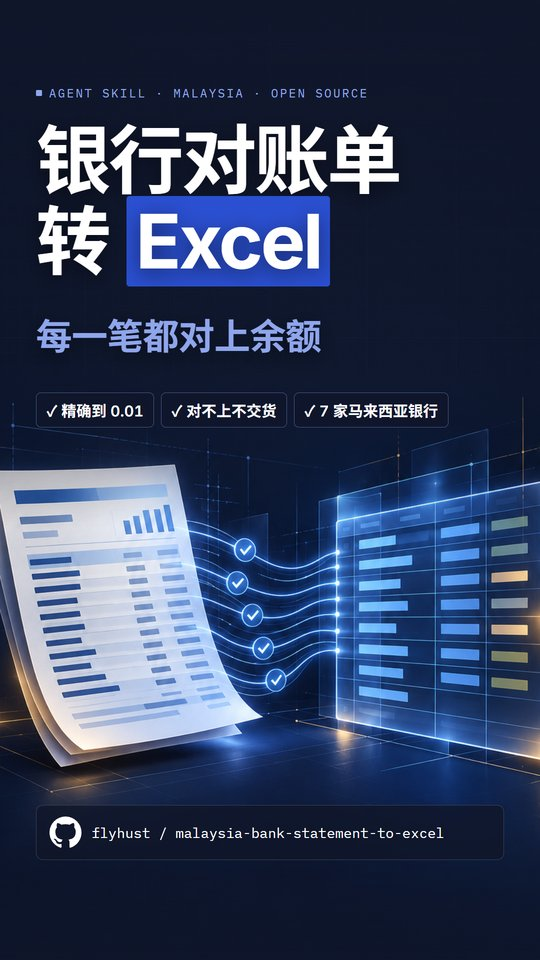

# malaysia-bank-statement-to-excel

<p align="center"></p>

An agent skill that turns **Malaysian** bank statements (PDF, scanned or digital) into an Excel workbook in **your** template, and refuses to hand it over until every row is proven by the bank's own balance chain and printed totals.

Supported (all Malaysia): Public Bank, Maybank, CIMB, RHB, Hong Leong, OCBC Malaysia, UOB Malaysia. Other banks work through the generic method, with less guidance.

Works with any agent that reads `SKILL.md` skills: Claude Code, Claude.ai, Codex, and others.

## Install

**Claude Code** (personal, all projects):

```bash
git clone https://github.com/flyhust/malaysia-bank-statement-to-excel ~/.claude/skills/malaysia-bank-statement-to-excel
```

**Codex**:

```bash
git clone https://github.com/flyhust/malaysia-bank-statement-to-excel ~/.codex/skills/malaysia-bank-statement-to-excel
```

Per-project instead: clone into `.claude/skills/` or `.agents/skills/` inside the repo.

**Claude.ai**: zip this folder and upload it under Settings → Capabilities → Skills.

The scripts need Python 3.9+ and `pip install openpyxl`.

## Use

> Convert these 12 Public Bank statements into my template (template.xlsx), one file per month.

The agent reads your template, transcribes, runs `scripts/verify.py`, fills with `scripts/fill_template.py`, reads the file back and re-checks it, then lists every judgement call it made.

## What's inside

| Path | What |
|---|---|
| `SKILL.md` | The method: principles, order of work, checks, delivery |
| `references/cleanup.md` | How Description / Counterparty are cleaned |
| `references/data-format.md` | Transcription JSON and the default template |
| `references/banks/*.md` | Layout notes per Malaysian bank (loaded only for the bank in hand) |
| `scripts/verify.py` | Balance chain, totals, counts, month-to-month continuity |
| `scripts/fill_template.py` | Fill a template (or the default), save, read back, re-check |
| `examples/sample.json` | Fictional two-month example |

## Contributing a bank

Copy `references/banks/_generic.md`, answer its five questions for your bank, and open a PR. **Use fictional names, account numbers and amounts only** — never paste a real statement.

## Learn to build tools like this

This skill was built with Claude Code and Codex. If you want to build your own: a tool for the task you repeat every week, or an AI agent that takes care of it, I run a two-day, hands-on weekend workshop in Kuala Lumpur. No coding background needed.

**万物皆可 Vibe Coding · AI Agent 线下班**: KL 周末两天实作课, 零基础可以。Day 1 做出你自己的工具, Day 2 搭你自己的 AI 助理。

👉 **[workshopai.victoraaa.my](https://workshopai.victoraaa.my/)**

## License

MIT
